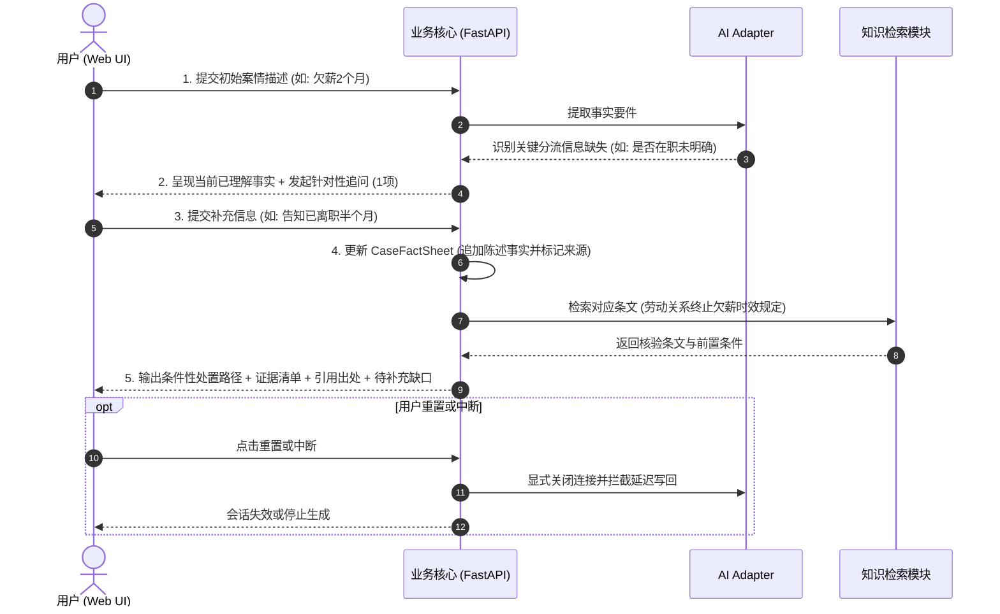

# OpenLawGuide 原型阶段配套详细设计规范
## Detailed Design Specification (v2.1 — Python / FastAPI)

> 关联文档：`legal_assistant_prd.md` (PRD v1.3)、`legal_case_rag_requirements_review.md` (v0.2)、`source_catalog_v1.md`、`schema/README.md`。  
> 状态：已按 PRD v1.3 与补充稿 v0.2 同步；案例契约、依据资格与能力边界已写入。法律规则核验、来源可访问性、性能实测与产品验收尚未完成。  
> 目标：将 PRD 确定的原则与边界精准转换为 Python 后端、数据结构及测试集的可实现、可度量规则。  
> 本轮修改前原文件备份为 `detailed_design_spec.v2.0.backup-20261019-before-sync.md`；原 Java 版本已备份为 `detailed_design_spec.v1.1.backup-java-20261019.md`。

---

## 1. 会话生命周期与取消机制规范

### 1.1 会话重置 (Session Reset)
* **语义定义**：重置表示"使既有会话失效并隔离引用"。Python 的垃圾回收由运行时控制，**不承诺对象内存立即被回收或物理清零**。
* **服务端行为**：
  1. 将指定 `session_id` 标记为 `INVALIDATED`，从活跃会话字典中删除引用。
  2. 触发该会话关联的所有正在执行的异步任务的取消流程（通过 `asyncio.Task.cancel()` 发送 `CancelledError`）。
  3. 设置并发写保护屏障：任何属于已失效会话的延迟回调或残留推理结果，一律禁止写回会话状态。可通过在写入前检查会话有效性标志实现。
  4. 为后续交互分配全新的随机 `session_id`。

### 1.2 客户端取消与下游信号传播 (Request Cancellation)
* **主动取消通道（主通道）**：
  - 前端点击"停止生成"时，除中止前端读取外，**必须显式向后端发送 `POST /api/chat/cancel`**，携带 `session_id` 与 `request_id`。
* **连接断开检测（兜底通道）**：
  - FastAPI 的 SSE/StreamingResponse 可通过 `Request.is_disconnected()` 轮询检测客户端断开。这不是即时通知，而是定期检查，因此显式取消接口是主通道。
* **下游适配器取消机制**：
  - **重要约束**：Python 的 `asyncio.Task.cancel()` 向协程注入 `CancelledError`，但底层 HTTP 客户端连接不会因此自动关闭。
  - 适配器层必须持有底层连接句柄或响应对象（例如 `httpx.AsyncClient` 的流式响应上下文、`aiohttp.ClientSession` 的响应对象），在收到取消信号时**显式调用 `response.aclose()` 关闭数据流**，并停止消费后续 Token。
  - 对于 Ollama 等本地服务，适配器应调用其取消 API 或断开 HTTP 连接以停止生成。
* **状态与计费边界**：
  - 服务端立即丢弃后续 Token，被取消的残缺文本严禁追加并持久化至正式会话历史。
  - 验收检查：验证取消接口触发后，下游读取通道是否关闭、残缺内容是否未写入会话。
  - *说明*：外部商用 API 服务商的具体计费粒度与内部计算停止时机依各服务商协议为准，系统不虚假承诺"立即可退费/立即停算"。

### 1.3 闲置过期、在途保护与冲突解决 (TTL & In-Flight Guard)
* **默认配置**：`SESSION_TTL_SECONDS = 1800`（默认 30 分钟，通过环境变量或配置文件可调）；`TASK_MAX_EXECUTION_SECONDS = 120`（单次任务最大执行保护超时）。
* **冲突解决与请求豁免**：
  1. **重置与取消操作豁免**：`POST /api/chat/cancel` 与 `POST /api/chat/reset` **不受 TTL 超时拒绝限制**，即便会话已逻辑超时，服务端依然执行清理与解引操作。
  2. **在途任务活动保护**：会话维护 `active_task_count`。正在生成中的会话，后台定时清理任务**不得将其强行从内存驱逐**；当任务执行超过 `TASK_MAX_EXECUTION_SECONDS` 时，触发超时取消（`Task.cancel()`），释放计数。
  3. **任务结束钩子**：正常生成结束或异常终止后（包括 `CancelledError` 被捕获后），更新 `last_accessed_at` 并扣减 `active_task_count`，随后恢复常规的空闲超时淘汰逻辑。计数扣减必须使用 `try/finally` 保证执行一次。
  4. **被动访问检查**：非豁免请求（常规对话发送）到达时，若 `now - last_accessed_at > TTL` 且 `active_task_count == 0`，拒绝请求并返回 HTTP 410 Gone（`SESSION_EXPIRED`）。

---

## 2. 事实契约与时间建模规范

### 2.1 事实枚举定义

```python
from enum import Enum

class UserConfirmationStatus(str, Enum):
    """用户确认状态：仅表示用户是否认可提取符合其陈述，不代表客观真实性已获司法认定。"""
    NOT_REQUESTED = "NOT_REQUESTED"      # 尚未要求用户确认
    CONFIRMED = "CONFIRMED"              # 用户确认该提取符合其陈述
    REJECTED = "REJECTED"                # 用户否认该提取项
    MODIFIED = "MODIFIED"                # 用户修正了提取内容

class EvidenceStatus(str, Enum):
    """材料/证据持有状态：记录用户出示或声称的情况。"""
    NOT_PROVIDED = "NOT_PROVIDED"         # 未提及任何凭证线索
    CLAIMED_EXISTS = "CLAIMED_EXISTS"     # 用户自称持有凭证，但尚未提供具体内容
    TEXT_PROVIDED = "TEXT_PROVIDED"       # 已在对话中提供凭证文字（如聊天记录复制、转账备注）
    DOCUMENT_ATTACHED = "DOCUMENT_ATTACHED"  # （后续扩展）已上传客观单据文件

class ConflictStatus(str, Enum):
    """事实冲突状态。"""
    NONE = "NONE"                        # 无冲突
    POSSIBLE = "POSSIBLE"                # 疑似存在语境或时序冲突（需向用户澄清）
    UNRESOLVED = "UNRESOLVED"            # 用户尚未澄清的冲突事实（阻断依赖该事实的结论推演）
    RESOLVED = "RESOLVED"                # 经过澄清并由用户修正后的事实

class FactSourceType(str, Enum):
    """事实来源类型。"""
    USER_STATEMENT = "USER_STATEMENT"       # 用户主动陈述
    DOCUMENT_CONTENT = "DOCUMENT_CONTENT"   # 提供的材料文本记载
    MODEL_HYPOTHESIS = "MODEL_HYPOTHESIS"   # 模型生成的待验证假设（严禁当作定案事实）
```

枚举继承 `str` 以便 JSON 序列化时直接输出字符串值，与 Pydantic 模型和 FastAPI 响应格式兼容。

### 2.2 事实数据模型

```python
from pydantic import BaseModel, Field
from datetime import datetime
from typing import Optional

class CaseFact(BaseModel):
    """单条案件事实。"""
    fact_id: str
    name: str
    value: str
    source_type: FactSourceType
    source_message_id: Optional[str] = None
    source_snippet: Optional[str] = None
    recorded_at: datetime
    user_confirmation: UserConfirmationStatus = UserConfirmationStatus.NOT_REQUESTED
    evidence_status: EvidenceStatus = EvidenceStatus.NOT_PROVIDED
    conflict_status: ConflictStatus = ConflictStatus.NONE
    conflicting_fact_ids: list[str] = Field(default_factory=list)
    supersedes_fact_id: Optional[str] = None
```

Pydantic 提供运行时类型校验与 JSON Schema 生成，无需额外的校验框架。字段默认值、必填约束与类型已在模型中完整定义。

### 2.3 时间与日期多态建模规范
严禁将无法核实起止的模糊表述机械强制转换为精确区间。

```python
class TemporalPrecision(str, Enum):
    EXACT_DATE = "EXACT_DATE"
    FUZZY_MONTH = "FUZZY_MONTH"
    FUZZY_APPROXIMATE = "FUZZY_APPROXIMATE"
    UNKNOWN = "UNKNOWN"

class DateCandidate(BaseModel):
    interpretation: str          # 如 "2025-03-01 to 2025-03-31"
    confidence: str              # HIGH / MEDIUM / LOW

class TemporalExpression(BaseModel):
    raw_statement: str           # 用户原始表述，如 "前段时间"
    reference_date: Optional[str] = None  # 解析基准日期
    precision_level: TemporalPrecision = TemporalPrecision.UNKNOWN
    parsed_candidates: list[DateCandidate] = Field(default_factory=list)
    confirmation_status: str = "PENDING_CONFIRMATION"
    recorded_at: datetime        # 系统对话记录时间
    event_occurrence_time: Optional[datetime] = None  # 案件事实发生时间
```
* **规则**：
  1. `recorded_at`（系统对话记录时间）与 `event_occurrence_time`（案件事实发生时间）严格拆分。
  2. 模糊词汇（如"前段时间"）保持 `precision_level: FUZZY_APPROXIMATE`，保留原始陈述；当且仅当法律关系存续或诉讼时效计算需要确定起算点时，才向用户发起针对性时间确认。

---

## 3. 评测评分细则与 PRD 约束继承

### 3.1 评分单元与三态判定
评测集中每个用例的各项检查点采用**三态判定**：
* `PASS`（合格）：行为完全符合预期标准。
* `FAIL`（不合格）：存在漏报、误判或违背原则。
* `NOT_APPLICABLE (N/A)`（不适用）：本题不应出现该项动作（例如：事实清楚的题目无需追问，或超出范围的题目严禁给出法律维权路径）。

### 3.2 评分计算与零分母处理
$$\text{检查项合格率} = \frac{\sum \text{PASS}}{\sum \text{PASS} + \sum \text{FAIL}}$$
* **规则**：
  - 检查项的分母严格排除 `NOT_APPLICABLE`。
  - 若某项指标在当前用例集中的适用数量为 0（即全部为 N/A），该项得分标记为 `N/A`，不参与平均计算。

### 3.3 PRD 验收约束继承与一票否决门槛
严格继承 PRD v1.3 第 6.1 节与第 2.2 节的硬性指标，不得以整体平均分稀释或替代单项要求：

1. **一票否决阻断条件（Critical Blocking Criteria）**：
   在指定评测集上，以下任一行为发生即判定该版本交付**阻断不合格**，必须修复后复测：
   - 伪造法律条文或出处来源；
   - 在 `LOCAL_ONLY` 模式下发生非环回网络外发；
   - 跨会话泄漏用户案情记录；
   - 将模型假设（`MODEL_HYPOTHESIS`）直接表述为既定事实；
   - 关键人身安全或救济权利丧失风险漏报（如遇急性伤害未优先提示就医与固定证据）；
   - 向用户输出错误的法定期间或无依据的确定倒计时（如算错时效起算或混淆工伤申报主体与期限）；
   - 在未建立/未核验规则的领域输出确定期限或确定程序结论，或用其他领域规则外推。
2. **专项指标硬性门槛**：
   - **关键事实抽取与必要追问**：合格率 $\ge 90\%$；
   - **条件性处置路径与可执行建议**：合格率 $\ge 90\%$；
   - **引用条文真实性与逐字一致性**：在指定测试集上通过率必须为 **100%**（注：仅代表测试集表现，非全域法律保证）；
   - **分类防遮蔽底线**：在满足上述条件的同时，TC-01 至 TC-09 中已评测类别，**任意单一类别的检查项合格率不得低于 80%**。
3. **独立评测报告原则**：
   - 使用 Mock/Stub（测试替身）跑通与真实模型跑通的结果，必须在评测日志中**严格分开标记与独立报告**，测试替身仅用于验证接口契约，不得作为模型能力达标证明。
   - 首批验收只到“导入 → 检索 → 引用 → 降级”的管线与契约，不宣布任何领域能力达标；未评测领域单列。

---

## 4. 检索、引用、法律适用与网络边界

### 4.1 停止输出实质法律结论的边界
**扩大明确约束**：不仅在"本地库损坏"时停止输出条文；当出现以下任意情形时，**系统严禁向用户输出确定性的法律适用结论**：
1. 本地库正常，但检索结果未命中直接依据；
2. 检索到的条文未通过逐字一致性核验；
3. 案件发生时适用的法规时效版本存疑或存在新旧法过渡期争议；
4. 用户提供的事实要件与法定适用条件之间缺乏关键支持证据；
5. 该领域的期限/程序/适用规则尚未建立或尚未核验（如刑事追诉时效、行政起诉期限）。

**历史版本与冲突**：适用版本按案件发生/行为时、行为持续状态、过渡规定与例外选择；**不得仅因文本当前失效而排除历史版本**，当前有效版本也不能自动替代历史版本。`repeal_date: null` 表示废止日期未知，不等于未废止。系统只做失效/未生效/版本时间等事实过滤；对特别法/新法、上位法关系只生成提示，冲突一律标“待核实/待裁决”，并列展示可能文本，不自动选择、不自行裁决。

### 4.2 引用资格、冲突处理与展示标签

**依据资格（Authority Eligibility）**：能否作为“本案处置法定依据”取决于文件性质、制定权限和适用条件，不只取决于位阶。数据层用 `authority_type` 记录：
- **裁判依据**：法律、行政法规、地方性法规等（具体以程序法/实体法规定为准）；
- **参照**：规章在行政诉讼中参照；
- **说理参考**：其他规范性文件、会议纪要/答复、案例等，不得单独作为裁判依据；
- **程序指引**：流程性材料，不能支撑实体结论。

**五要件闭环（原四联闭环 + 依据资格）**：`事实要件具备 ↔ 法定适用条件对应 ↔ 逐字核验通过 ↔ 版本确认适用 ↔ 依据资格成立`。仅满足全部条件才可标注 `【本案处置法定依据】`；案例只能标 `【类案参考】`，不得替代法条。

**冲突处理（首版保守策略）**：系统只做失效/未生效/版本时间等事实过滤；对特别法/新法、上位法关系只生成提示；冲突一律标“待核实/待裁决”，并列展示可能文本，不自动选择、不自行裁决。部分冲突需依法定程序裁决，系统不得代替。

**候选参考资料**：检索召回的背景法条，在案件事实未完全匹配前仅标 `【相关背景法条参考】`（附核验时间戳）。

**标准话术**：
- 检索未命中：
  > "本次检索未找到可核验的直接法规依据。以下建议仅为证据收集与一般处理常识，不作为确定性法律依据。"
- 领域未验证：
  > "该领域的期限/程序规则尚未完成核验，本次不给出确定期限或确定程序；以下仅为一般性材料准备建议。"
- 版本不确定：
  > "案件发生时的适用版本尚不能确定。以下并列展示可能文本，请以官方文本和专业意见为准。"

### 4.3 案例数据与检索契约

案例与法条分开建模，案例不替代法条。机器可读 Schema v0 见 `schema/case_document.schema.json`，字段说明、首批必填子集与正反样例见 `schema/README.md`。

#### 4.3.1 案例文档模型

每条案例对应一个 `case_document`，至少包含：

- **标识**：`case_id`、案号（缺失允许为空）、案例库入库编号、标题、法院、审级、审理程序、裁判类型、裁判日期、发布日期、地域、来源 URL、来源主体、原文快照/校验值。
- **案由/罪名**：原始表达、标准化值、标准化所依据的版本（民事案由规定/刑事罪名规定）。
- **身份（多标签）**：`identity[]`，可同时包含指导性案例、人民法院案例库参考案例、公报刊载、典型案例、地方参考性案例、最高检案例、普通裁判文书；每项记录授予主体、文件/批次、日期、来源、核验状态（`VERIFIED/UNVERIFIED/UNKNOWN`）、核验时间（可空）、规范效果（“应当参照/参考/无正式参照效力”）。未核验身份只能给 `UNKNOWN` 规范效果，不得展示为已确认身份。
- **内容分区**：诉辩主张、法院认定事实、争议焦点、证据及采信、程序经过、裁判理由、适用依据、裁判结果、官方要旨、模型总结。每段含 `text`、`locator`（原文起止/段落号）、`extract_method`、`model_version`、`review_status`、`subject_label`（原告/被告/第三人/公诉人/辩护人/法院）。
- **适用法律**：`applicable_law_versions[]`（法规 ID + 版本 ID + 条号 + 裁判时适用依据），用于类案可比性判断。
- **关联裁判**：`related_cases[]`（同案不同审级、串案、改判/再审关系及状态）。
- **状态**：`effective_status`（裁判生效/改判/再审/不再参照）、`public_status`、`collection_policy`、`last_verified_at`。
- **官方要旨**：`official_gists[]`，按来源分别保存“裁判要点/裁判要旨/裁判摘要/典型意义”，各自带 `text`、`source`、`locator`；不得合并成单一 `official_gist` 字段。
- **模型总结**：`model_summary` 可缺省或为 `null`（尚未生成），不得为满足 Schema 编造模型版本或摘要；存在时标记为模型提取并带模型版本/审校状态；展示层不得使用“法院认为/法院认定”。

#### 4.3.2 案例检索接口

- 输入：事实要素、争议焦点、领域、地域、事件/裁判时间、审级、身份、适用法律版本、程序类型。
- 输出：候选列表，每项含 `case_id`、相似点、差异点、身份、裁判日期、审级、生效状态、引用标签、原文定位、限制说明。
- 关键词/向量/元数据过滤均为待实测方案；未评测前不得宣称优于关键词基线。默认同时检索支持与不支持/不同方向的案例，不只检索支持用户立场的案例。

#### 4.3.3 引用卡片与展示标签

每张案例引用卡片至少包含：案号、法院、审级、裁判日期、身份及来源、生效/改判状态、来源 URL、原文定位、覆盖声明。

标签分三类：`【本案处置法定依据】`（仅限有依据资格的法条/司法解释等）、`【类案参考】`（案例说理/尺度参考）、`【背景资料】`（未满足条件）。案例摘要不得显示为法院认定，模型总结不得冒充官方要旨。

#### 4.3.4 覆盖声明与降级

- 案例检索覆盖 = 入库/已发布案例；普通文书为可选扩展。回答必须声明覆盖范围，不宣称全量类案。
- 未检索到案例不等于不存在类似案例，不得用“无案例”推断法律结论。
- 身份无法核验、原文定位失败、模型总结未审校时，降级为背景资料或拒绝作为类案参考。

#### 4.3.5 法条与案例联合检索

先按领域、时间、地域、版本确定候选法条；再按事实要素与争议焦点检索案例；案例结果必须回链到法条版本与原文段落。法条与案例分别标注依据资格/参考性质，不合并为同一“依据”。

### 4.4 离线可用性与 `LOCAL_ONLY` 网络边界
* **网络请求与 IPC 严格限定**：
  - `LOCAL_ONLY` 模式下的"禁止外部网络请求"，**仅允许访问宿主机本地环回网络（Loopback / `127.0.0.1` / `localhost` / `::1`）或本地进程间通信（IPC，如 Unix Domain Socket / 命名管道）**运行的模型推理服务（如 Ollama、llama.cpp、vLLM）。
  - **严禁向任何局域网其它主机（如同一局域网下的其它 IP 地址）或公网外发任何包含用户咨询案情的数据包**。
  - **推理引擎外发合规约束**：被调用的本机模型推理服务本身亦必须处于隔离或无遥测状态，不得在后台向外部云端转发案情输入。
* **离线本地库可用性**：
  - 当外部法律网站离线或断网时，系统**继续正常使用本地已入库并带有核验时间戳的法规数据**，并在界面标明核验基准时间；不因外部网络中断而关闭本地合法检索。
* **独立维护命令解耦**：
  - 离线下载模型权重、更新法规语料属于独立的管理员维护脚本，执行时严禁携带或包含任何用户的历史咨询会话数据。

---

## 5. Python 技术选型说明

### 5.1 核心框架与依赖
以下为首期原型建议选型，实际采用前须通过小范围验证：

| 职责 | 建议方案 | 选型理由 |
|------|---------|---------|
| Web 框架 | **FastAPI** | 原生 async/await 支持，内置 Pydantic 校验与 OpenAPI 文档生成，SSE 流式响应通过 `StreamingResponse` 实现。 |
| 数据校验 | **Pydantic v2** | FastAPI 内置依赖，运行时类型校验、JSON Schema 生成、枚举序列化一体化。 |
| HTTP 客户端（调用 LLM API） | **httpx** | 支持 async、流式读取、请求超时与显式取消（`response.aclose()`），兼容 OpenAI 兼容协议。 |
| 测试 | **pytest + pytest-asyncio** | Python 生态标准测试框架，原生支持异步测试与 fixture。 |
| 配置管理 | **pydantic-settings** | 从 `.env` 文件和环境变量加载配置，类型安全，与 Pydantic 模型统一。 |

不强制引入 LangChain、LlamaIndex 等大型编排框架。首期直接调用 LLM HTTP API（OpenAI 兼容协议或 Ollama REST API），用最少的抽象验证业务逻辑。如后续检索与编排复杂度增长，可按需评估引入。

### 5.2 模型适配接口

```python
from abc import ABC, abstractmethod
from typing import AsyncIterator
from dataclasses import dataclass

@dataclass
class LlmRequest:
    messages: list[dict]       # OpenAI 格式消息列表
    temperature: float = 0.3
    max_tokens: int = 2048

@dataclass
class LlmChunk:
    text: str
    finish_reason: str | None = None

class LlmClient(ABC):
    """统一模型调用接口。实现类负责持有底层连接并支持显式取消。"""

    @abstractmethod
    async def generate_stream(self, request: LlmRequest) -> AsyncIterator[LlmChunk]:
        """流式生成。调用方可在任意时刻取消外层 Task 以中断生成。
        实现类必须在被取消时关闭底层 HTTP 连接。"""
        ...

    @abstractmethod
    async def close(self) -> None:
        """释放底层连接池等资源。"""
        ...
```

* `ApiClient` 实现：通过 `httpx.AsyncClient` 调用 OpenAI 兼容 API（DeepSeek、通义千问等），持有流式响应上下文，`CancelledError` 时在 `finally` 中调用 `response.aclose()`。
* `LocalClient` 实现：通过 `httpx.AsyncClient` 调用本地 Ollama（`http://127.0.0.1:11434`），同样持有并显式关闭流式响应。
* 两者协议能力不完全相同（如结构化输出支持、上下文窗口大小），不承诺无需适配即可切换。

### 5.3 流式响应与取消的 Python 实现要点
* FastAPI 通过 `StreamingResponse` + `async def event_generator()` 实现 SSE。
* 生成器内部需定期调用 `await request.is_disconnected()` 检测客户端断开（这是轮询而非即时回调，因此显式取消 API 为主通道）。
* 取消逻辑：收到 `/api/chat/cancel` 后，服务端通过 `asyncio.Task` 引用调用 `.cancel()`，在 `LlmClient` 实现的 `finally` 块中关闭底层流。
* `asyncio.Task.cancel()` 注入 `CancelledError` 到协程等待点，但如果协程正在执行 CPU 密集操作或阻塞 I/O（非 async），`CancelledError` 不会立即生效。适配器中的长阻塞操作应通过 `asyncio.to_thread()` 隔离并检查取消标志。

### 5.4 会话内存管理
* 首期使用 Python `dict` 作为进程内会话存储（`sessions: dict[str, SessionState]`）。
* `SessionState` 包含 `CaseFactSheet`、消息历史、`active_task_count`、`last_accessed_at`、有效性标志。
* 后台通过 `asyncio.create_task()` 启动定期清理协程（如每 5 分钟检查一次过期会话）。
* Python 的 GC 在引用清除后自动回收对象，但**时间不确定**。不对清理后内存状态作物理擦除承诺。

---

## 6. 首个最小闭环（Walking Skeleton）交付边界

> 范围说明：本节以劳动欠薪/离职场景作为 walking skeleton 示例，不定义产品覆盖范围；跨领域目录、案例契约与能力边界见 PRD §1/§4 与本文件 §4.2–§4.4。首批验收只验证管线与契约，不验证领域可靠。

首期工程不追求全量法规导入，目标锁定在跑通**第一条完整的多轮闭环交互链路**：



### 6.1 验收标准
1. **多轮流转验证**：跑通上述 1 至 5 步的完整多轮流转，证明"事实提取 → 缺口追问 → 状态更新 → 检索输出"链路可用。
2. **重置与取消验证**：通过显式调用 `/api/chat/cancel` 验证流关闭与防止脏写入；通过 `/api/chat/reset` 验证会话隔离与任务清理。
3. **测试替身隔离**：首期集成测试允许使用 Mock 替身走通契约流转，但在测试报告中明确标注"契约测试（Mock）通过"，不作为真实模型通过依据。
4. **案例链路（可选）**：若首批样本含案例，验证“案例检索 → 身份标注 → 引用卡片 → 覆盖声明/降级”链路；不要求覆盖全部领域。

---

## 7. 修订说明

### 7.1 v2.1 修订说明

- 同步 PRD v1.3 与补充稿 v0.2：综合目录 + 分领域验证、案例契约、依据资格、能力边界。
- 新增 §4.3 案例数据与检索契约（文档模型、身份、检索接口、引用卡片、覆盖声明、降级）。
- 四联闭环扩展为五要件，增加依据资格；冲突只提示、不自动裁决；历史版本按案件时间选择，不因当前失效排除。
- 新增未验证领域/版本不确定/案例不可核验的降级话术。
- 首批验收只到管线与契约，不宣布领域能力达标。
- 原 v2.0 备份为 `detailed_design_spec.v2.0.backup-20261019-before-sync.md`。

### 7.2 v2.0 修订说明

- 技术栈从 Java / Spring Boot 迁移至 Python / FastAPI，反映用户决定。
- 所有 Java 枚举替换为 Python `str, Enum`；数据模型替换为 Pydantic `BaseModel`。
- `CompletableFuture.cancel(true)` / OkHttp / WebClient 等 Java 特定取消机制替换为 `asyncio.Task.cancel()` + `httpx` 流式响应关闭。明确 `CancelledError` 注入时机与限制。
- Spring Boot 特定的连接断开检测替换为 FastAPI 的 `Request.is_disconnected()` 轮询机制，并说明其非即时特性。
- JVM 垃圾回收表述替换为 Python GC 对应说明。
- 新增第 5 节：Python 技术选型说明，覆盖框架选择理由、模型适配接口、流式响应实现要点与会话内存管理。
- 产品要求、安全边界（含 LOCAL_ONLY 网络限定）、一票否决阻断条件与评测规则不变。
- 原 Java 版本已备份为 `detailed_design_spec.v1.1.backup-java-20261019.md`。
